<div align="center">

# AEGIS · Crew Health Companion

**When help is twenty light-minutes away.**

A crew health companion for long space missions. It reads live NASA space weather and real astronaut blood data, and five specialist AI agents explain what is happening, what to do and what comes next. Every sentence cites NASA research.

*Built for the 2026 NASA Space Apps Challenge, challenge "Create health monitoring software for astronauts on space missions".*

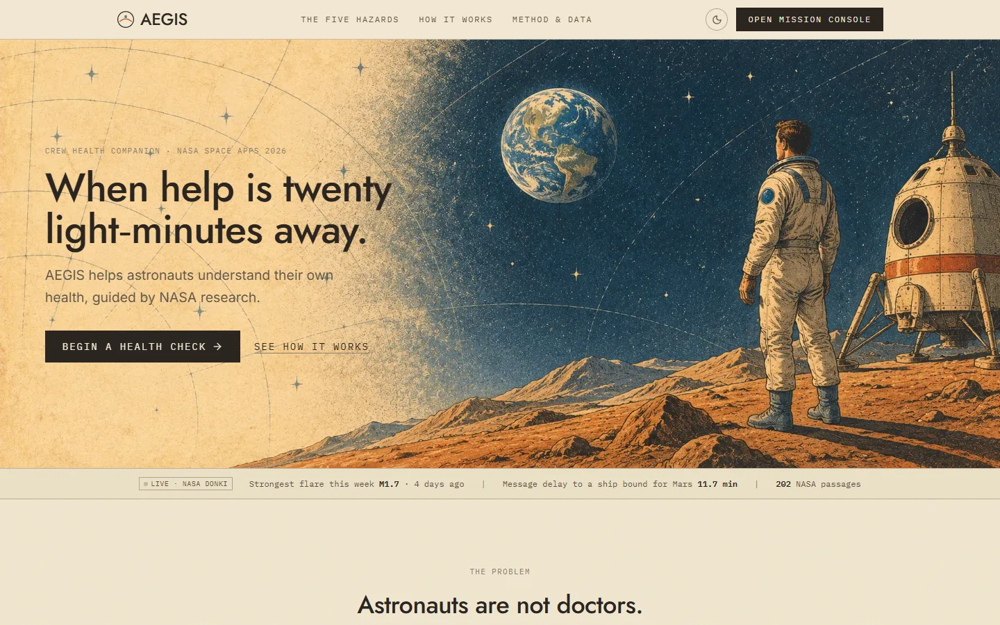

</div>

---

## 1. The problem

Missions to the Moon and Mars expose astronauts to radiation, isolation, altered gravity and a sealed, hostile environment, all far from Earth.
On a Mars mission a message to Mission Control takes up to 20 minutes each way, so the crew must notice, measure and act on health changes themselves.
But astronauts are not doctors, and health data is scattered across sensors, lab tests and dense research.
They need a tool that turns readings into clear, trustworthy guidance: *what does this mean for me, and what should I do now?*

## 2. Our idea

**AEGIS** is built around NASA's **five hazards of human spaceflight**, each watched by its own AI specialist:

| Specialist agent | Watches |
|---|---|
| **Space Radiation agent** | Live solar flares, particle events and solar storms (NASA DONKI), cumulative dose |
| **Isolation & Confinement agent** | Sleep, mood, reaction time |
| **Distance from Earth agent** | Communication delay, evacuation options, medical autonomy |
| **Gravity Fields agent** | Blood pressure, heart rate, bone and blood markers, gravity transitions |
| **Hostile & Closed Environments agent** | Cabin CO₂ and temperature, body temperature, immune markers |

**How it works for the astronaut**

- **Proactive briefing.** When the dashboard changes, the relevant agents search AEGIS's NASA knowledge base, and a coordinator writes one calm briefing: *what is happening · what to do now · what comes next*.
- **Every claim is cited.** Any statement without a valid source is removed before the astronaut sees it.
- **Ask anything.** Answers stream in, cited, with the agents' work shown live, for example *"The Gravity Fields agent found 6 NASA passages…"*.
- **Memory.** AEGIS remembers the conversation and facts the astronaut shares about themselves ("I sleep badly after night shifts"). The astronaut can see and delete these.
- **Guided check-ins.** For each measurement: how to take it, why it matters in space, and what is typical. Heart rate can even be measured with the device camera.
- **Emergency mode.** Calm, pre-written steps for chest pain, collapse or trouble breathing. They are never generated by AI. A report to the flight surgeon is drafted automatically, with its arrival time shown.
- **Built to be trusted.** Status (nominal / watch / alert / critical) is decided by fixed, readable rules, never by the AI. Every number shows its source: *Live*, *Real data* or *Simulated*.

### A look inside

| | |
|---|---|
| 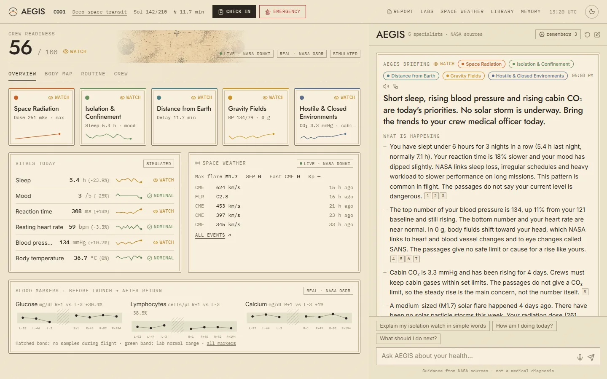 | 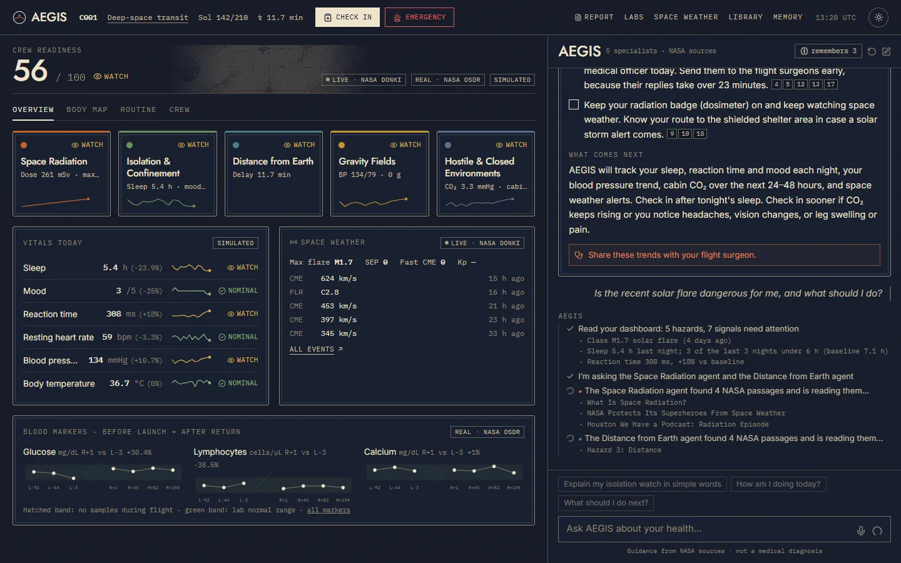 |
| **Mission console:** a compact dashboard that fits one screen, with the AEGIS briefing on the right | **Live agent steps:** each specialist's search, passages found and summary, streamed in real time |
| 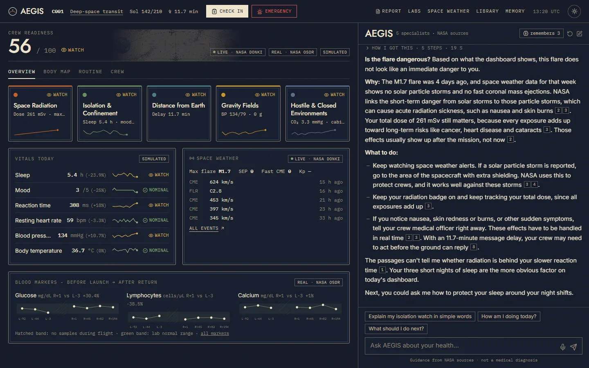 | 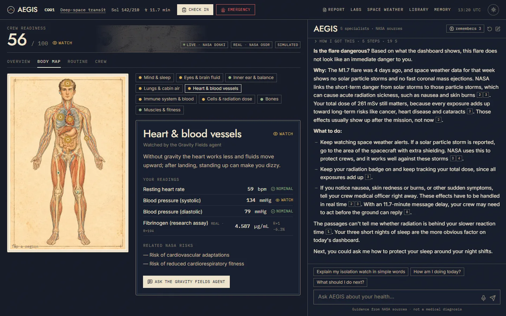 |
| **Cited answers:** every sentence links to the NASA passage it came from (night mode) | **Body map:** a vintage anatomical plate whose regions glow by status and open readings and risks |
| 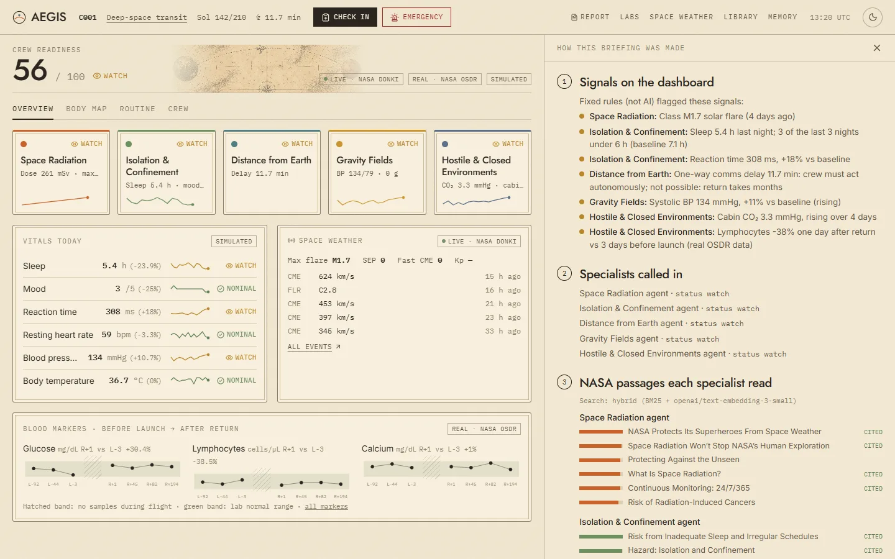 | 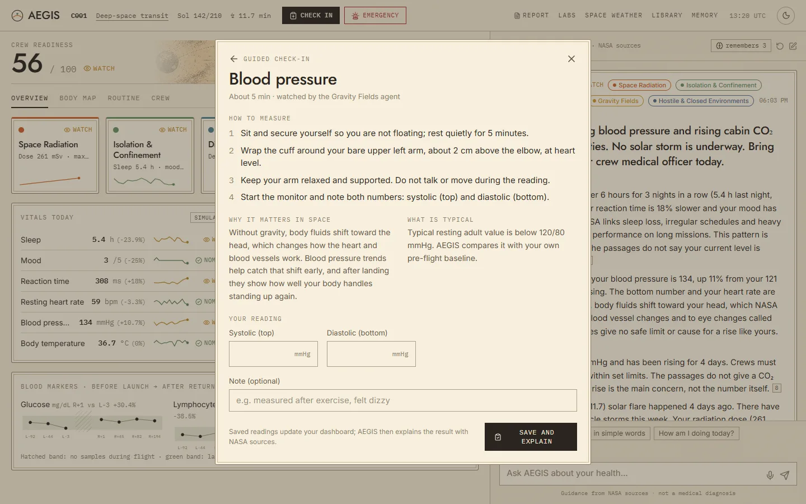 |
| **How this was made:** signals → agents → passages → findings → checks | **Guided check-in:** how to measure, why it matters, what is typical |
| 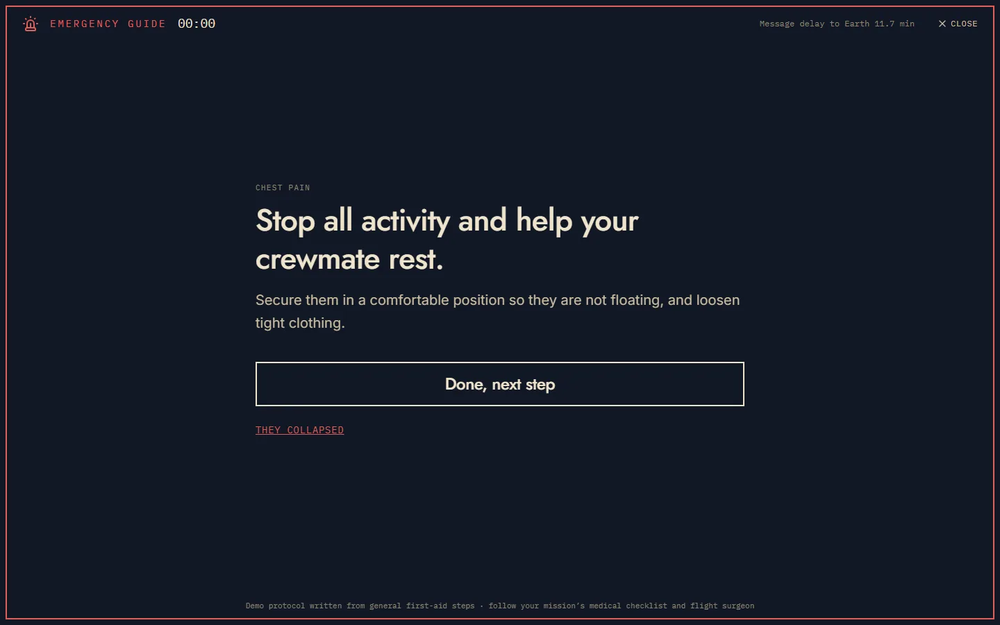 | 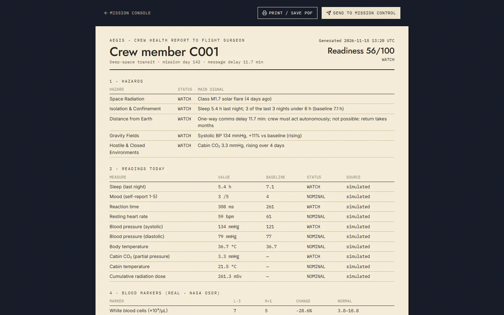 |
| **Emergency mode:** one step per screen, big buttons, elapsed timer | **Report to Earth:** printable sheet, sent with a live arrival countdown |

<details>
<summary><b>More features</b></summary>

- **Mission setup:** choose a crew member (C001–C004) and where the mission is: space station, Moon base, Mars base or deep-space transit. This changes gravity, comms delay and radiation dose rate.
- **Scenarios:** mid-mission check, **landing day** (gravity transition after months of weightlessness) and all nominal.
- **Solar storm replay:** the real May 2024 storm from NASA DONKI.
- **Daily routine:** check-in schedule, streaks, badges and cooperative crew points.
- **Crew overview:** all four astronauts at a glance.
- **Voice:** ask questions out loud; briefings and answers can be read aloud.
- **Day and night modes.** Clinical labs explorer, space weather page and searchable knowledge library.

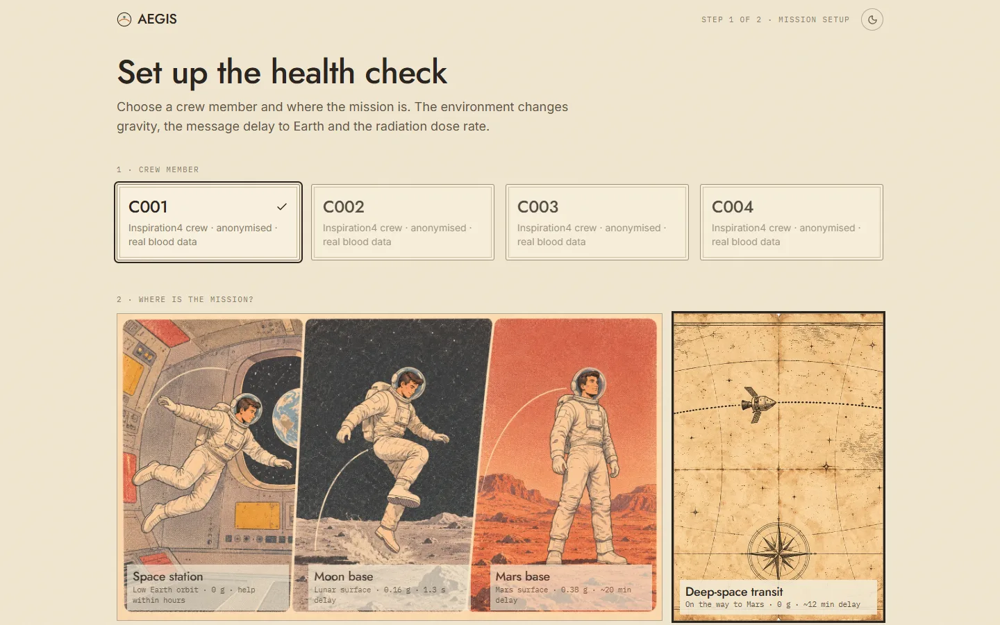
</details>

## 3. The tech

### Data: real where possible, always labelled

| Source | What we use | Label in the app |
|---|---|---|
| **NASA DONKI** (CCMC) | Live solar flares, solar energetic particles, CMEs, geomagnetic storms | `Live · NASA DONKI` |
| **NASA OSDR: Inspiration4** (OSD-569, OSD-575) | Real blood count, metabolic and cardiovascular panels for 4 civilian astronauts, before launch and after return | `Real · NASA OSDR` |
| **Simulated telemetry** | Sleep, mood, reaction time, heart rate, blood pressure, cabin CO₂, radiation dose, anchored to published NASA study values | `Simulated` |
| **Astronaut check-ins** | Readings entered through guided check-ins (or the camera) | `Logged by you` |
| **Knowledge base** | 202 passages from the NASA Human Research Program (hazards, 17 risks, ongoing research), NASA podcasts and videos, and the Canadian Space Agency | cited `[n]` |

### Architecture

| Layer | Built with |
|---|---|
| **Frontend** | React 19 · TypeScript · Vite · Tailwind CSS 4 · React Router · streaming via `fetch` + server-sent events |
| **Backend** | Python · FastAPI · SQLite (sessions, memories, check-ins, reports) |
| **Reasoning** | **OpenAI GPT-5.5** (coordinator, chat) and **GPT-5.4-mini** (5 hazard agents, memory): strict JSON-schema outputs, streaming. Claude can be switched in with `LLM_PROVIDER=anthropic` |
| **Retrieval (RAG)** | Hybrid search: **BM25** keyword + **OpenAI `text-embedding-3-small`** vectors, fused with Reciprocal Rank Fusion, filtered by hazard |
| **Knowledge base build** | Word sources split along their own headings (never summarised), each chunk tagged with hazard, NASA risk, source URL and heading path; duplicates and boilerplate removed |
| **Rules engine** | Readable thresholds turn data into hazard status and *triggers*; the AI never sets status |
| **On-device** | Camera heart rate (fingertip photoplethysmography), speech recognition and read-aloud, all in the browser |

### Flow

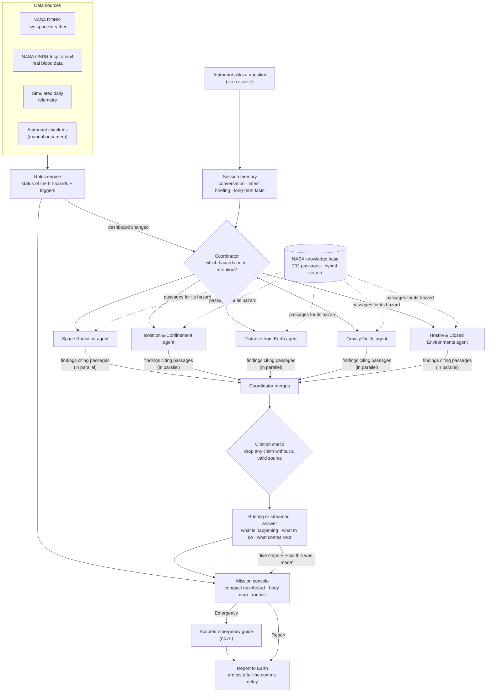

## 4. The impact

- **For astronauts:** a calm second opinion that is always on board. It turns numbers into plain-language guidance, explains *why*, and says when to involve the flight surgeon, so the crew can act during a communication delay instead of waiting for Earth.
- **For flight surgeons:** compact, cited, time-stamped reports that arrive ready to act on, which makes every message across the delay count.
- **For trust and safety:** rules decide status, the AI only explains, every claim is cited, emergency steps are scripted, and data sources are always visible. That's the kind of transparency a medical support tool needs.
- **Back on Earth:** the same pattern helps people far from care: remote research stations, ships, rural clinics, polar bases. Guidance can be grounded in a trusted knowledge base and work when a doctor is hours away.
- **For learning:** it makes NASA's Human Research Program understandable. Each hazard, risk and finding is one click away, with its original source.

## 5. Run it locally

**You need:** Python 3.11+, Node.js 20+ and an OpenAI API key (used for both reasoning and embeddings).

```bash
# 1 · backend
cd backend
python -m venv .venv
.venv/Scripts/pip install -r requirements.txt        # macOS/Linux: .venv/bin/pip
cp .env.example .env                                 # add OPENAI_API_KEY
.venv/Scripts/uvicorn app.main:app --port 8000       # API docs: http://localhost:8000/docs

# 2 · frontend (new terminal)
cd frontend
npm install
npm run dev                                          # open http://localhost:5173
```

**Notes**

- **First start:** the 202 knowledge-base chunks are embedded once (about 12 s) and cached. Without an OpenAI key, a local embedding model is downloaded instead.
- **Without an API key:** everything except briefings and chat works (search falls back to keywords plus a local embedding model).
- **Rebuilding the knowledge base** from the Word files: `cd backend && .venv/Scripts/python scripts/build_kb.py`.
- **Tests:** `cd backend && .venv/Scripts/python -m pytest -q`.
- **Demo shortcut:** `/console?ask=How am I doing today?` opens the console and asks automatically.

## Project structure

```
backend/            FastAPI app: data sources, rules engine, retrieval, agents, memory, tests
  app/data/         donki.py (live) · labs.py (real OSDR) · telemetry.py (simulated + logged) · environments.py
  app/engine/       hazards.py: rules → status + triggers
  app/kb/           retriever.py: hybrid BM25 + embeddings
  app/agents/       orchestrator.py · prompts.py · llm.py (OpenAI, or Claude as an option)
  app/memory/       store.py: SQLite sessions, memories, check-ins, reports
  scripts/          build_kb.py: Word files → knowledge-base chunks
frontend/           React app (pages, assistant, body map, check-ins, emergency, report)
knowledge-base/     sources/ (NASA HRP & CSA documents, video transcripts) · processed/ (202 chunks)
data/inspiration4/  real NASA OSDR blood panels
docs/               challenge brief, research notes, design notes, screenshots
images/             original illustrations
```

## Credits and sources

- **NASA Human Research Program:** the five hazards, the risks of human spaceflight, and ongoing research.
- **NASA DONKI** space weather database (Community Coordinated Modeling Center).
- **NASA Open Science Data Repository:** Inspiration4 studies OSD-569 and OSD-575 (Overbey et al., *Nature* 2024).
- **Canadian Space Agency:** radiation monitoring and space science.
- **Illustrations:** generated for this project in a vintage scientific style.

> **Disclaimer:** AEGIS gives guidance drawn from NASA sources. It is **not a medical device** and does not diagnose. Status thresholds are demonstration values, not clinical or NASA flight rules, and the emergency steps are demo protocols. Daily readings marked *Simulated* are demo telemetry.
